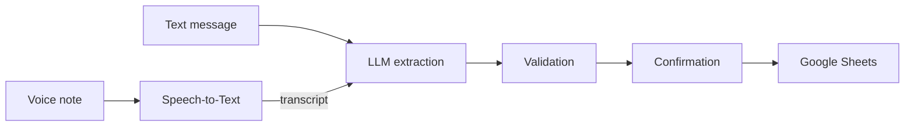

<p align="center">
  
</p>

<h1 align="center">Telegram Expense Tracker</h1>

<p align="center"><b>Log expenses by chatting: a text or voice message in, a row in your Google Sheet out.</b></p>

<p align="center">
  <a href="#how-it-works">How it works</a> · <a href="#quickstart">Quickstart</a> · <a href="docs/self-hosting.md">Self-hosting</a> · <a href="#license">License</a>
</p>

A personal-use Telegram bot that turns a plain-language message like *"spent
30000 at the supermarket today"* into a structured row in a Google Sheet.
Send a text or a voice note, an LLM extracts the date, description, amount,
category and expense type, the bot confirms the parse back to you, and on
confirmation it appends the row via the Google Sheets API.

This is a single-user, personal-finance tool, published here as a portfolio
piece — see [Contributions](#contributions) below.

<p align="center">
  
</p>

<p align="center"><sub>Animated mockup of the real conversation flow, not a screen recording.</sub></p>

> **Language note:** the bot itself talks in Rioplatense Spanish — its
> replies, button labels, commands, LLM prompt and log messages are all in
> Spanish, since it was built for an Argentine user. The demo above and
> every example in these docs are English translations.

## How it works



1. **Telegram** — a text message or voice note arrives via long polling
   (local development) or a webhook (production, Cloud Run). Voice notes
   take a detour first: they're capped at 60 seconds, downloaded from
   Telegram and transcribed with Google Cloud Speech-to-Text. The transcript
   then joins the text path right before LLM extraction — from there on,
   both go through the exact same code.
2. **LLM extraction** — one of three interchangeable providers infers
   everything it can from the message in a single pass: date, description,
   amount, category, expense type. It never asks clarifying questions
   mid-flow. Categories aren't hard-coded: they're read at runtime from the
   spreadsheet itself.
3. **Validation** — the only thing that can truly block a message is a
   missing amount or description; date, category and expense type always
   get a sensible default instead of prompting.
4. **Confirmation** — the bot shows a summary with two inline buttons,
   Confirm and Edit, before anything is written.
5. **Google Sheets** — on confirmation, the row is inserted via a service
   account (no interactive OAuth), into one of two tabs depending on the
   expense type: day-to-day or one-off.

Besides logging expenses, the bot has a few commands: `/gastos` (Spanish for
"expenses"), a guided query where you pick a category, then a period — today,
this week, this month, the last 3/6/12 months, year to date, or a custom
date range — all through inline buttons; `/cancel` to drop a pending
confirmation; `/help`; and `/version` (app version, active LLM provider and
process uptime).

## Design decisions

**Three LLM providers behind one interface.** `ExpenseInterpreter` defines a
single `interpretExpense()` contract; Claude, Gemini and Ollama each
implement it independently and are selected by an env var, not a branch
inside shared code. Claude uses real JSON-Schema structured outputs; Gemini
and Ollama don't enforce a schema, so their output can come back with
missing or malformed fields.

**One trust boundary.** Because two of the three providers don't guarantee
well-formed output, every interpreter returns raw, untyped JSON — nothing is
cast to the expected shape at the source. A single validation layer is the
only code that trusts LLM output: it fills in safe defaults for
inferable fields and only rejects a message when the amount or description
is genuinely absent. This keeps "the LLM said something weird" from ever
becoming a runtime type error somewhere downstream.

**Two thin entrypoints, one bot definition.** The bot's handlers are defined
once and imported by two tiny entrypoints — one that starts long polling
(local development) and one that serves a webhook behind an HTTP server
(the Cloud Run/Docker deploy target). Neither entrypoint has hidden
side effects on import, so the same code can't accidentally boot in the
wrong mode.

**Single-instance state, by design.** The bot keeps a small in-memory map of
"pending" expenses awaiting a Confirm/Edit tap — there's no database.
That's only safe with exactly one live process, which is why the Cloud Run
deploy is capped at `--max-instances=1`. If the service ever needed to scale
past one instance, this would need to move to shared storage; for a
single-user, low-volume bot that tradeoff hasn't been worth the extra
moving part.

**Multiple expenses per message.** A single message can describe more than
one purchase (e.g. "5000 groceries + 40000 gas"). The LLM only *splits* into
independent items — summing and grouping stay deterministic code, not
something delegated to the model.

## Stack

- **TypeScript** (Node.js)
- **[grammY](https://grammy.dev/)** for the Telegram Bot API
- **Google Sheets API** (service account, no interactive OAuth)
- **Google Cloud Speech-to-Text** for voice notes
- **LLM providers**: Anthropic Claude, Google Gemini, or local Ollama —
  chosen at runtime via a single env var, all implementing the same
  interface

## Quickstart

The fastest way to see it working is local long polling — no public URL,
no Docker, no Cloud Run.

```bash
# after cloning this repo and cd-ing into it:
npm install
cp .env.example .env   # then fill it in, see below
npm run dev            # long polling with auto-reload
```

`.env` needs five things. Each links to its step in the
[self-hosting runbook](docs/self-hosting.md):

| Variable | What it is |
|---|---|
| `TELEGRAM_BOT_TOKEN` | Your bot's token from @BotFather — [step 1](docs/self-hosting.md#1-create-the-bot-on-telegram) |
| `OWNER_TELEGRAM_ID` | The only Telegram user the bot will answer — [step 2](docs/self-hosting.md#2-find-your-owner_telegram_id) |
| `LLM_PROVIDER` + its key | `claude`, `gemini` or `ollama` — [step 3](docs/self-hosting.md#3-pick-an-llm-provider) |
| `GOOGLE_SERVICE_ACCOUNT_KEY` | Service account JSON for Sheets (and Speech-to-Text) — [step 4](docs/self-hosting.md#4-google-sheets-access-google_service_account_key--spreadsheet_id) |
| `SPREADSHEET_ID` | The target spreadsheet, which needs a specific tab layout — [make a copy of the template](https://docs.google.com/spreadsheets/d/1TV_XWT2u95OiUpnrW2npxongEbXZuyGBtJxNT0ItzWE/copy), see [step 4](docs/self-hosting.md#4-google-sheets-access-google_service_account_key--spreadsheet_id) |

Then message your bot something like *"spent 5000 on groceries"*. Voice
notes additionally need Speech-to-Text enabled
([step 5](docs/self-hosting.md#5-voice-notes-google-cloud-speech-to-text));
text works without it.

## Deploying and operating it

The reference deployment runs in webhook mode on Cloud Run, capped at a
single instance. The [self-hosting runbook](docs/self-hosting.md) covers the
rest: the webhook secret, a step-by-step `gcloud` deploy, registering the
webhook, running the container locally with Docker, reading logs, and
troubleshooting (including a workaround for networks that block Telegram).

## Status

The core loop — text or voice message in, confirmed expense row out — is
implemented and working end to end: single- and multi-item messages,
category/expense-type inference, the Confirm/Edit flow, and the `/gastos`
query. The bot runs both as a local long-polling process and as a
Cloud Run webhook service.

The roadmap is tracked privately and isn't reflected here.

## Contributions

This is a personal project and does not accept external contributions or
pull requests. Feel free to fork it for your own use under the license
below.

## License

[MIT](LICENSE)
